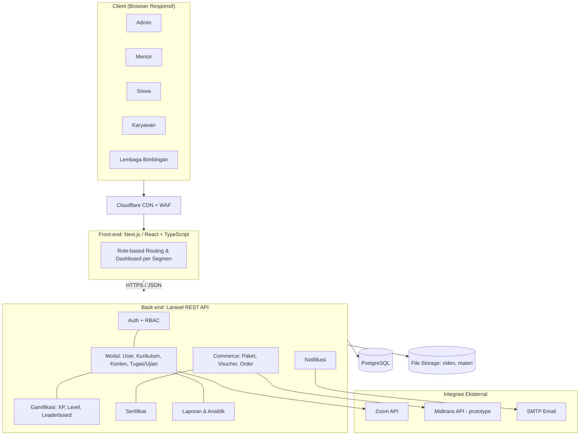
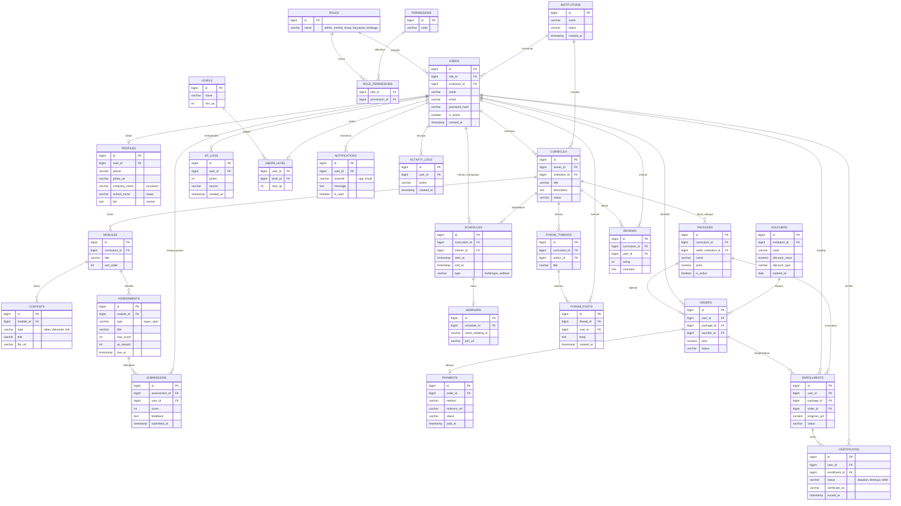
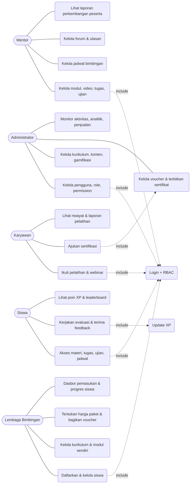
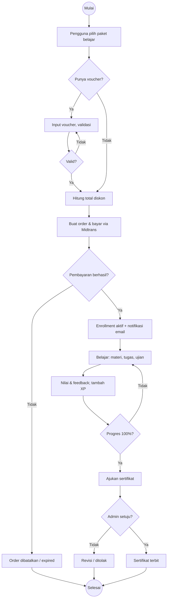
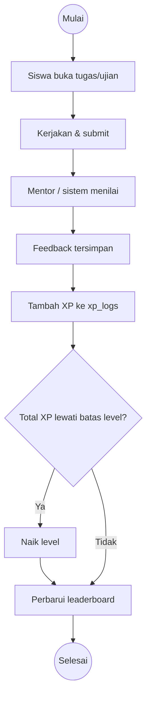
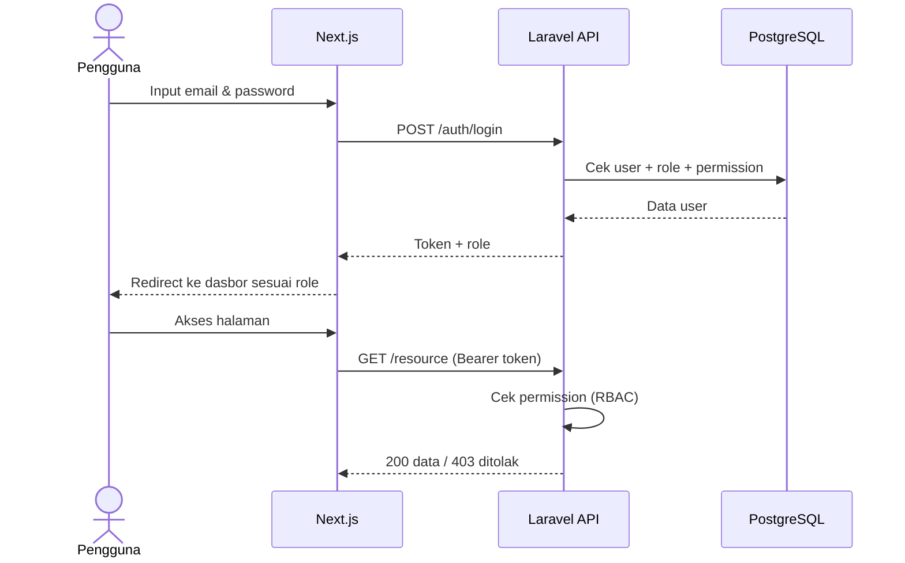
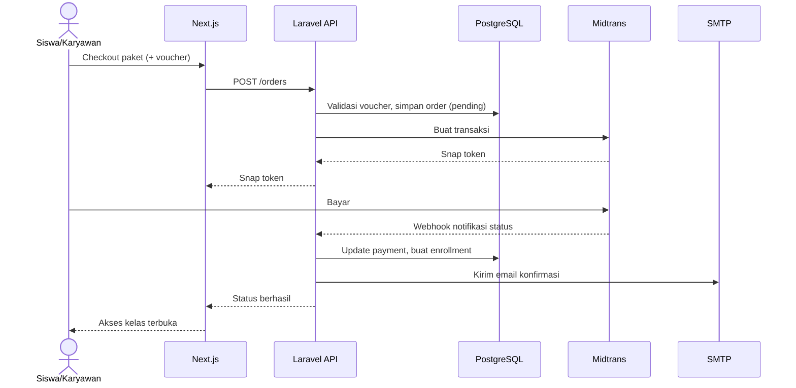
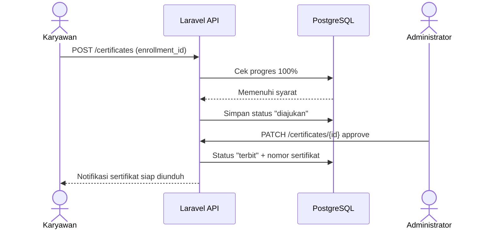

# Desain Sistem LMS Multi Segmen — LE Academy

Turunan dari PRD: Arsitektur Sistem, ERD PostgreSQL, dan UML (Use Case, Activity, Sequence).

## 1. Arsitektur Sistem

Catatan: Midtrans pada ruang lingkup PRD hanya sampai prototype antarmuka; API disiapkan sebagai titik integrasi masa depan.

## 2. ERD (PostgreSQL)

Leaderboard dibuat sebagai VIEW/materialized view dari `users_level.total_xp` (tidak perlu tabel terpisah). Indeks disarankan pada `users.email` (unique), `enrollments(user_id, package_id)`, `xp_logs(user_id, created_at)`.

## 3. UML

### 3.1 Use Case Diagram

Semua aktor juga memiliki use case "Kelola profil & keamanan akun".

### 3.2 Activity Diagram — Pembelian Paket hingga Sertifikat

### 3.3 Activity Diagram — Pengerjaan Evaluasi & Gamifikasi

### 3.4 Sequence Diagram — Login & RBAC

### 3.5 Sequence Diagram — Pembayaran Paket

### 3.6 Sequence Diagram — Pengajuan Sertifikat

